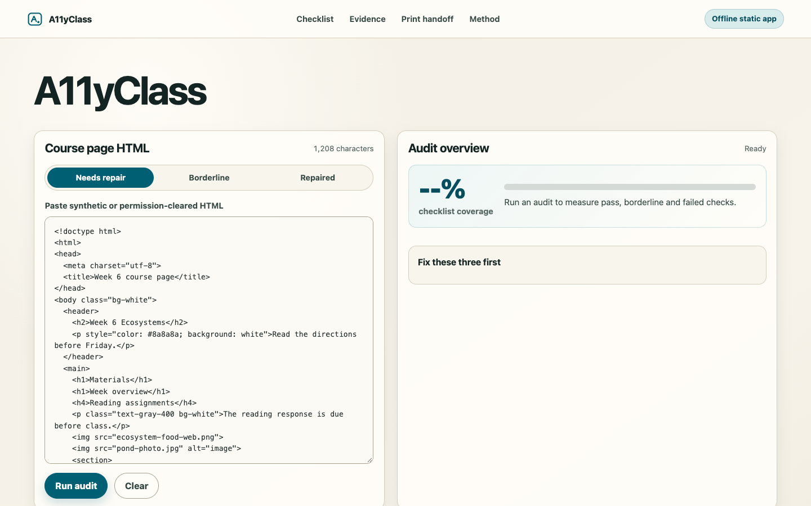
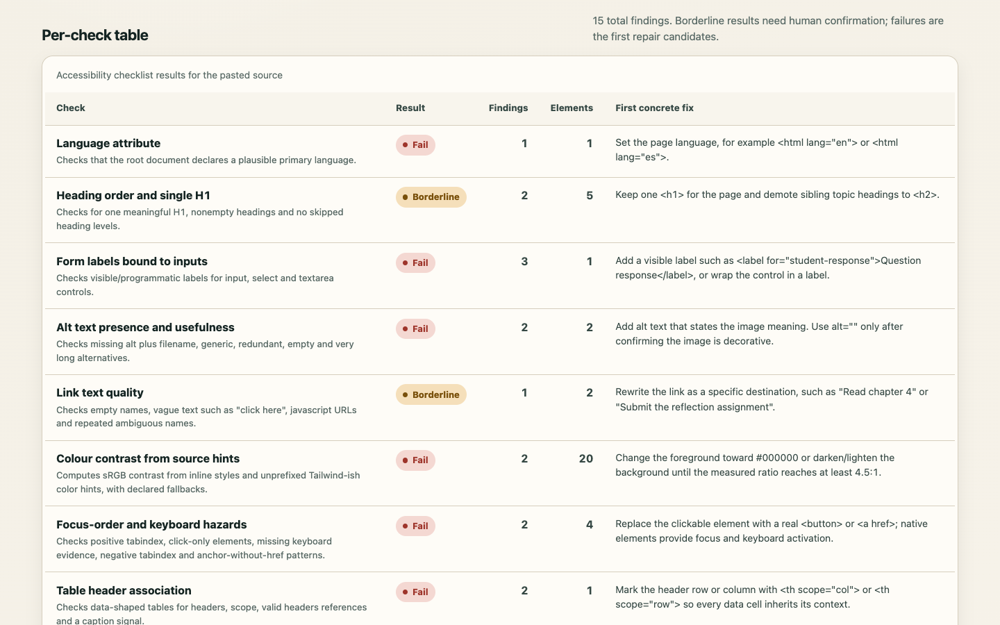
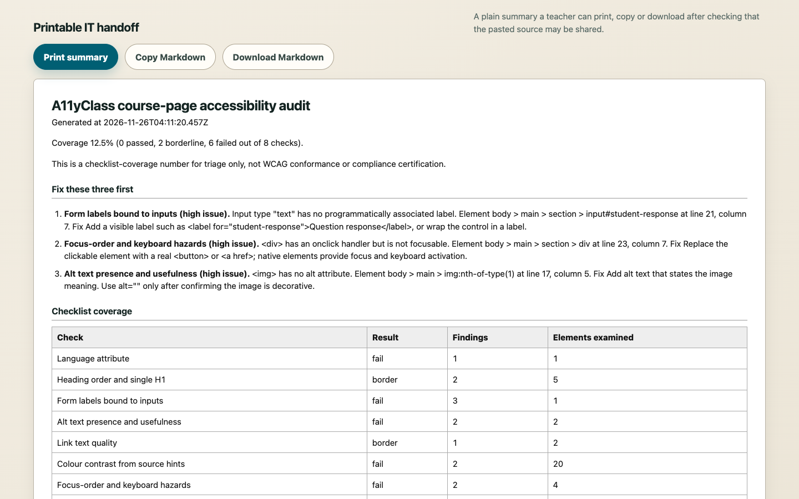

# A11yClass

A11yClass is an offline accessibility auditor for a teacher's course page. Paste synthetic or permission-cleared HTML and the prototype runs eight named source checks, ranks the first three repairs, and creates a printable summary a teacher can hand to IT.

**Intended learner.** A student using a screen reader or keyboard-only navigation.

**Task.** Find the week's reading and submit an assignment.

**Barrier removed.** The teacher often never finds out that a page is unusable until a student gives up. A11yClass makes concrete barriers visible before publication.

Everything runs in the browser. There are no runtime dependencies, accounts, uploads, network calls or student records. The examples are synthetic.

## Run locally

Requires Node.js 22 or newer for the test and helper scripts. The app itself is plain HTML, CSS and JavaScript.

```sh
npm start
```

Open the loopback URL printed by the server. Any static host can serve the same files.

## Test and verify

```sh
npm test
npm run browser:check
npm run shots
```

`npm test` uses `node --test` only. `browser:check` drives locally installed headless Chrome over the DevTools protocol. `shots` writes the three committed 1440 by 900 PNG screenshots in `screenshots/`.

## The eight checks

| Check | Pass means | Borderline means | Fail means |
| --- | --- | --- | --- |
| Language attribute | The root `<html>` has a plausible nonempty `lang` | The pasted source is a fragment or the tag shape looks malformed | `<html>` lacks a usable language |
| Heading order and single H1 | One meaningful H1 and ordered nested headings | Multiple H1s or a skipped level needs human review | No headings, no H1, or empty headings |
| Form labels bound to inputs | Controls have label, ARIA or equivalent programmatic names | Duplicate ids, orphan labels or weak title-only naming | A control has no programmatic label |
| Alt text presence and usefulness | Images have concise meaningful alternatives | Empty, generic, filename-like, redundant or very long alt needs review | An image or image input lacks `alt` |
| Link text quality | Links name their destinations | Vague text such as "click here" or repeated ambiguous text | Empty link text or a `javascript:` URL |
| Colour contrast from source hints | Measured text clears the WCAG AA threshold for its size | A pass is within 0.3 of the threshold | Measured contrast is below the threshold |
| Focus-order and keyboard hazards | No static positive tabindex or click-only hazards | Positive tabindex, unproven custom keyboard support or anchor without `href` | A click-only control cannot receive focus, or a native control is removed from tab order |
| Table header association | Data tables have scoped headers and a caption signal | Missing scope, missing caption or an unclear small table | A data-shaped table has no headers or broken `headers` references |

## What the score means

Coverage is counted as passed checks plus half credit for borderline checks, divided by the eight checks in this prototype. It is intentionally simple and visible in the report. It is a checklist-coverage number, not a compliance score, not WCAG certification and not proof that a page is accessible.

## Contrast method and fallback

The auditor implements WCAG sRGB relative luminance. It reads inline `color`, `background`, `background-color`, font size and font weight declarations, plus unprefixed Tailwind-ish hints such as `text-red-500`, `bg-white`, `text-[#123456]`, `font-bold` and `text-xl`. State and responsive variants are not guessed. When a foreground or background is missing, the stated fallback is black text `#111111` on white `#ffffff`. External CSS can change the real result, so the report repeats this assumption beside the finding.

## Honest limits

1. This is a static source audit. It does not execute JavaScript, load external CSS, render the page or measure browser-computed styles.
2. The HTML parser is deterministic but not the full HTML Living Standard parser. Malformed input is repaired conservatively and parse notes are reported.
3. Accessible names are approximations, not the browser accessible-name algorithm.
4. Empty alt text is flagged for review because source alone cannot prove that an image is decorative.
5. Custom keyboard controls need testing with a real keyboard and screen reader even when the static check finds no hazard.
6. A pass does not certify WCAG conformance. Use this prototype for triage, then test with assistive technology and disabled users.

## Screenshots







## Demo video

The committed demo is `video/demo.mp4`. It is generated offline with `video/steps.json` and synthesized narration in `video/narration.wav`.

## AI disclosure

Aariv Patel directed the product concept and requirements. AI assistance helped implement, test and document the prototype. The submitted fixtures are synthetic and contain no private student records or grades.

## License

MIT. See `LICENSE`.
